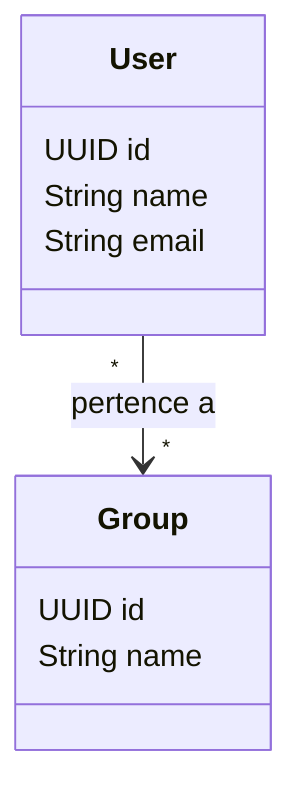

# 000 - Contexto do User

<!--
Modelo de contexto. Copie para docs/<contexto>/000_<contexto>_context.md
junto com a primeira operação, e troque o exemplo (User) pelo seu contexto.
-->

Um usuário é uma pessoa com acesso ao sistema. Ele se identifica pelo e-mail e pode pertencer a vários grupos.

## Modelo

<!-- As entidades do contexto e como se relacionam. -->

## Operações

Em ordem de criação:

<!-- Status: Pendente (sem spec), Rascunho, Aprovado, Concluído, Descartado. -->

| Ordem | Operação | Status | Documento |
| --- | --- | --- | --- |
| 001 | Register User | Concluído | [001_register_user.md](001_register_user.md) |
| 002 | Update User | Rascunho | [002_update_user.md](002_update_user.md) |
| 003 | Delete User | Pendente | — |
