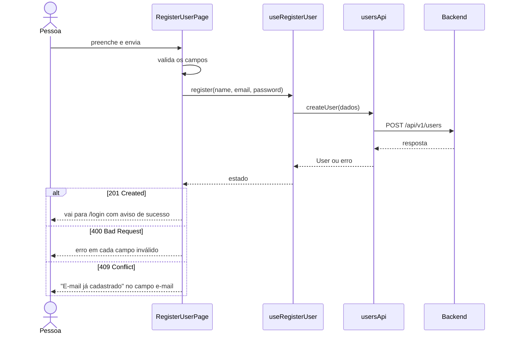
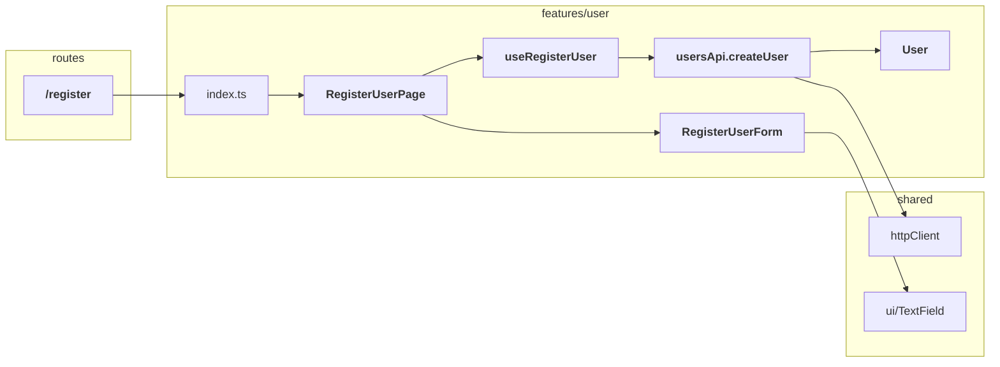

# NNN - Register User

<!--
Modelo de spec de operação. Copie para docs/<contexto>/NNN_<operação>.md e
troque o exemplo (tela de cadastro de usuário) pela sua operação. Prefira
diagramas e tabelas a parágrafos: cada seção responde uma pergunta em poucos
segundos.
-->

| Status | Origem | Contexto |
| --- | --- | --- |
| Rascunho | <de onde veio a necessidade>, AAAA-MM-DD | [User](000_user_context.md) |

<!-- Status: Rascunho → Aprovado → Concluído (ou Descartado). -->

Tela em que a pessoa cria a própria conta com nome, e-mail e senha.

## Problema

Hoje não há como uma pessoa criar a própria conta: o acesso depende de alguém cadastrá-la manualmente.

## Objetivos e fora do escopo

| Objetivos | Fora do escopo |
| --- | --- |
| Formulário com validação antes de enviar | Confirmação de e-mail |
| Mostrar o erro de e-mail já cadastrado no campo | Login após o cadastro |

## Fluxo

## Estrutura

<!-- Os arquivos por pasta. Em negrito o que esta operação cria. -->

## Mudanças no que já existe

<!-- Uma linha por arquivo já existente que a operação altera, cria ou remove. Remova a seção na primeira operação do contexto. -->

| Onde | Membro | Mudança |
| --- | --- | --- |
| `features/user/index.ts` | `RegisterUserPage` | Novo export |
| `shared/ui/TextField` | prop `error` | Nova: mostra a mensagem embaixo do campo |

## Tipos

### User

| Campo | Tipo | Regras na tela |
| --- | --- | --- |
| `name` | `string` | Obrigatório, até 100 caracteres |
| `email` | `string` | Obrigatório, formato de e-mail |
| `password` | `string` | Obrigatório, mínimo 8 caracteres; nunca guardado no navegador |

## Erros

| Situação | Resposta da API | O que a pessoa vê |
| --- | --- | --- |
| Campo inválido | 400 | A mensagem embaixo do campo |
| E-mail já cadastrado | 409 | "E-mail já cadastrado" no campo e-mail |
| Falha de rede | — | Aviso no topo com "Tentar de novo" |

## Contrato

| Rota do app | Acesso | API consumida |
| --- | --- | --- |
| `/register` | Pública | `POST /api/v1/users` ([api.md](../api.md)) |

## Decisões

<!-- Uma linha por escolha não óbvia; o conteúdo fica na decisão, não aqui. -->

| Decisão | Por quê, em uma frase |
| --- | --- |
| [0001 - Validação repete as regras do backend](../decisions/0001-validacao-repete-o-backend.md) | Erro antes de enviar, sem esperar a API |

## Resultado

<!-- Preenchido quando a operação é concluída: o PR e o que mudou em relação ao planejado. -->

| PR | Diferenças do planejado |
| --- | --- |
| #<número> | Nenhuma |
