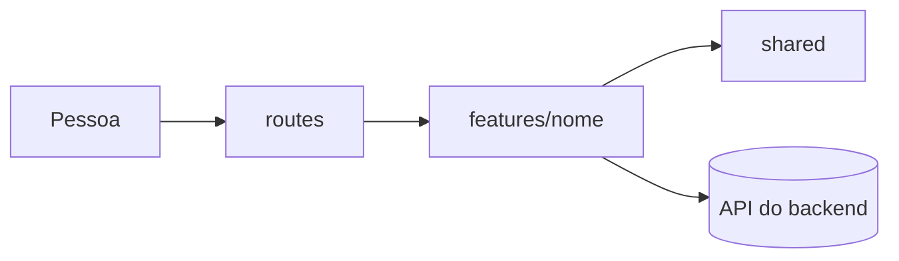

# Arquitetura

<!-- Visão geral do app. Muda pouco: ao adicionar uma dependência, uma feature, uma rota ou uma chave no navegador. Os fluxos de cada operação ficam nas specs. -->

<Uma frase: o que o app é, quem usa e com quais APIs ele fala.>

## Stack

| Tecnologia | Versão | Para quê |
| --- | --- | --- |
| <Framework> | <versão> | Rotas e renderização |
| <Linguagem> | <versão> | Linguagem |

## Dependências

<!-- Uma linha por dependência adicionada além da stack, com a decisão que a aprovou quando houver. -->

| Dependência | Versão | Para quê | Decisão |
| --- | --- | --- | --- |

## Estrutura

O código é organizado por feature: tudo que uma feature precisa (UI, estado,
acesso a dados, tipos, testes) fica na sua pasta.

| Caminho | Papel | Pode importar |
| --- | --- | --- |
| `<routes>` | Pontos de entrada do framework (páginas, layouts): finos, compõem features | features, `shared` |
| `features/<nome>` | Uma feature: componentes, estado, acesso a dados, tipos e testes | seus arquivos, `shared`, o `index.ts` de outras features |
| `shared` | Usado por mais de uma feature: UI, utilitários, clientes | `shared` |

- Uma feature expõe o que outras podem usar só pelo seu `index.ts`.
- `shared` nunca importa uma feature.
- Código vai para `shared` só quando uma segunda feature precisa dele.

## Componentes (React)

Composição em vez de configuração: conteúdo e comportamento entram por
`children`, slots e componentes compostos (`<Card>`, `<Card.Header>`).

- Variante nova é composição nova, não um booleano ou prop `variant` novo.
- Componentes compostos compartilham estado por context do pai.
- Prefira passar um elemento (`icon={<Icon />}`) a passar dados para o componente renderizar.

## Features

| Feature | O que faz | Contexto |
| --- | --- | --- |

## Rotas

| Caminho | Feature | Acesso |
| --- | --- | --- |

## Armazenamento no navegador

<!-- Cookies, localStorage e sessionStorage. -->

| Chave | Onde | Conteúdo | Validade |
| --- | --- | --- | --- |
